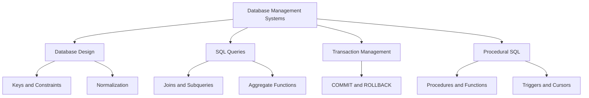

# 🗄️ Database Management Systems Laboratory

<p align="center">
  
  
  
</p>

<p align="center">
  
</p>

<p align="center">
  A collection of DBMS laboratory experiments, SQL scripts, database design examples, and PL/SQL programs for learning, practice, and revision.
</p>

<p align="center">
  <b>Learn • Query • Design • Analyze</b>
</p>

---

## 👨‍💻 Author

- **Name:** PARAMATHMUNI VENU SRI GAUTHAM
- **Repository:** DBMS Laboratory
- **Domain:** Database Management Systems
- **Languages:** SQL and PL/SQL
- **Database Platforms:** MySQL 8.0+ and Oracle Database

---

## 🎯 Project Overview

This repository contains ten DBMS laboratory experiments covering fundamental and advanced database concepts.

It is designed to help students understand relational database design, data manipulation, integrity constraints, SQL queries, normalization, database relationships, and procedural database programming.

### 📚 What You'll Learn

<p align="center">
  
  
  
  
  
</p>

- Database creation and table management
- SQL data insertion, updating, and deletion
- Constraints and data integrity
- Aggregate functions and subqueries
- Joins and relational operations
- Views, indexes, and savepoints
- Database normalization from 1NF to 5NF
- PL/SQL procedures, functions, triggers, and cursors

---

## 📑 Experiment Index

| No. | Experiment | Topics Covered | Script |
|---|---|---|---|
| 01 | Database Creation and Retrieval | CREATE, SELECT, filtering | [Open SQL](EXPERIMNTS/Experiment-01.sql) |
| 02 | Data Manipulation and Alteration | INSERT, UPDATE, DELETE, ALTER | [Open SQL](EXPERIMNTS/Experiment-02.sql) |
| 03 | Data and Transaction Control | DCL, TCL, COMMIT, ROLLBACK | [Open SQL](EXPERIMNTS/Experiment-03.sql) |
| 04 | Constraints and Data Integrity | PRIMARY KEY, FOREIGN KEY, UNIQUE, CHECK | [Open SQL](EXPERIMNTS/Experiment-04.sql) |
| 05 | Advanced SQL Queries | Subqueries and set operators | [Open SQL](EXPERIMNTS/Experiment-05.sql) |
| 06 | Aggregate Functions and Reports | COUNT, SUM, AVG, GROUP BY, HAVING | [Open SQL](EXPERIMNTS/Experiment-06.sql) |
| 07 | Views, Indexes, and Savepoints | Views, AUTO_INCREMENT, indexes | [Open SQL](EXPERIMNTS/Experiment-07.sql) |
| 08 | Database Normalization | 1NF, 2NF, 3NF, BCNF, 4NF, 5NF | [Open SQL](EXPERIMNTS/Experiment-08.sql) |
| 09 | Relationships and Joins | JOINs and subqueries | [Open SQL](EXPERIMNTS/Experiment-09.sql) |
| 10 | Procedural SQL Programming | PL/SQL blocks, procedures, functions, triggers, cursors | [Open SQL](EXPERIMNTS/Experiment-10.sql) |

---

## 🧩 Database Concepts at a Glance



---

## 🛠️ Technologies and Tools

<p>
  
  
  
</p>

- **MySQL Workbench:** For running Experiments 01–09.
- **MySQL Command-Line Client:** For executing MySQL scripts.
- **Oracle SQL Developer:** For executing Experiment 10.
- **Oracle SQL*Plus:** For command-line PL/SQL practice.
- **Git and GitHub:** For source control and sharing the project.

---

## 🚀 How to Use This Repository

1. Clone or download this repository.
2. Open the experiment you want to practice.
3. Select the correct database platform.
4. Read the SQL statements and comments.
5. Execute the script in a test database.
6. Review the query results and practice modifying the examples.

### Clone using Git

```bash
git clone https://github.com/YOUR-USERNAME/DBMS.git
cd DBMS
```

Replace `YOUR-USERNAME` with your GitHub username.

---

## 📂 Repository Structure

```text
DBMS/
├── CERTIFICATES/
├── EXPERIMNTS/
│   ├── Experiment-01.sql
│   ├── Experiment-02.sql
│   ├── Experiment-03.sql
│   ├── Experiment-04.sql
│   ├── Experiment-05.sql
│   ├── Experiment-06.sql
│   ├── Experiment-07.sql
│   ├── Experiment-08.sql
│   ├── Experiment-09.sql
│   └── Experiment-10.sql
└── README.md
```

Note: The folder name `EXPERIMNTS` is retained to match the existing repository structure.

---

## ⚠️ Important Notes

- Experiments 01–09 are intended for MySQL 8.0+.
- Experiment 10 uses Oracle PL/SQL syntax.
- SQL syntax and features can differ between MySQL and Oracle.
- Review scripts before executing statements that create, modify, or delete database objects.
- Expected results may vary depending on the database version and sample data.

---

## 🌟 Learning Goals

By completing these experiments, learners can develop practical skills in:

- Relational database design and normalization
- Writing efficient SQL queries
- Applying keys and integrity constraints
- Retrieving and analyzing data using joins and aggregation
- Managing transactions
- Developing PL/SQL programs

---

<p align="center">
  
  
</p>

<p align="center">
  <b>Learn SQL by writing queries, understanding relationships, and working with data.</b>
</p>

<p align="center">
  Created by <b>PARAMATHMUNI VENU SRI GAUTHAM</b>
</p>
